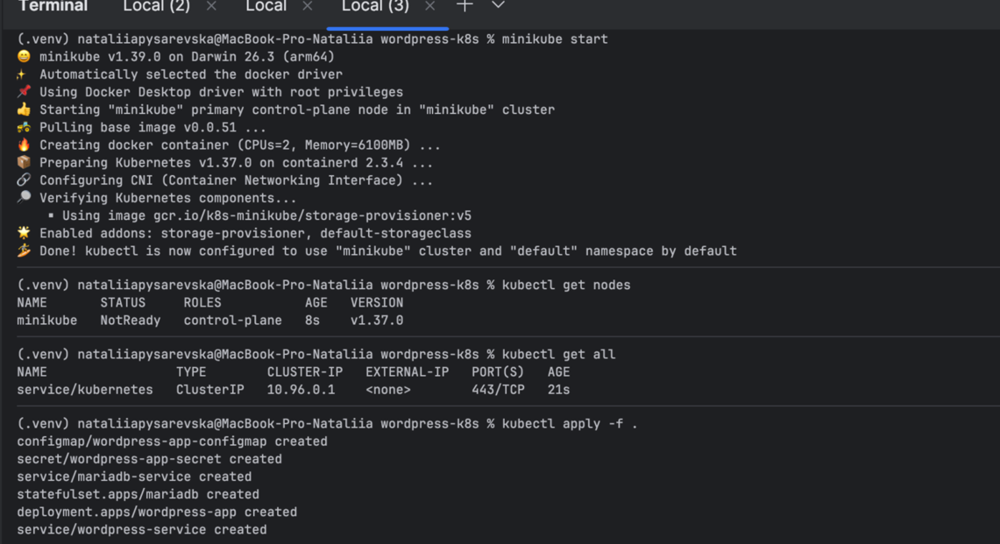
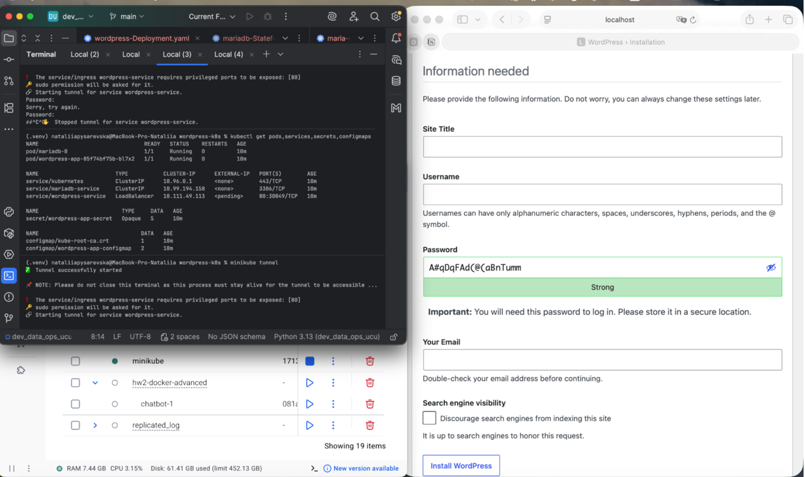
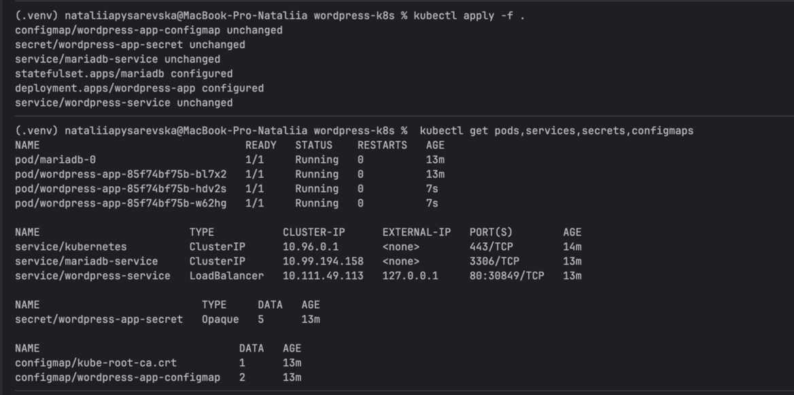

# WordPress + MariaDB on Kubernetes

This project converts a multi-container Docker Compose application consisting of WordPress and MariaDB into Kubernetes resources.

The original Docker Compose application contains:

* WordPress as the web application
* MariaDB as the backend database
* Persistent storage for MariaDB data

# Kubernetes Resources

The Docker Compose application was converted into the following Kubernetes resources:

### WordPress

* **Deployment** — runs the WordPress application with 3 replicas
* **LoadBalancer Service** — exposes the WordPress UI

### MariaDB

* **StatefulSet** — runs the MariaDB database
* **ClusterIP Service** — provides internal access to MariaDB on port 3306
* **PersistentVolumeClaim** — created automatically using volumeClaimTemplates in the StatefulSet to persist MariaDB data

### Configuration

* **ConfigMap** — stores non-sensitive configuration:
    * database name
    * database host
* **Secret** — stores database credentials:
    * database user
    * database password
    * root password

----------

# Run the Application

Start the local Kubernetes cluster:

```minikube start```

Apply all Kubernetes manifests:

`kubectl apply -f .`

Check the created resources:

`kubectl get pods,services,secrets,configmaps,pvc`

To expose the WordPress LoadBalancer service when using Minikube:

`minikube tunnel`

WordPress is then available at: http://localhost:80


----------

# Screenshots

Result after applying manifests (with 1 replica):



Result after exposing WordPress service:



Result after changing replicas from 1 to 3:

